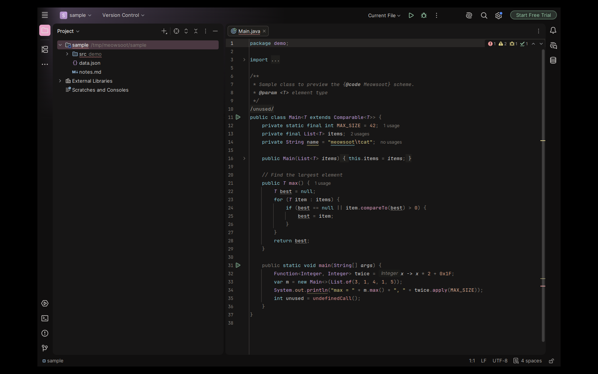
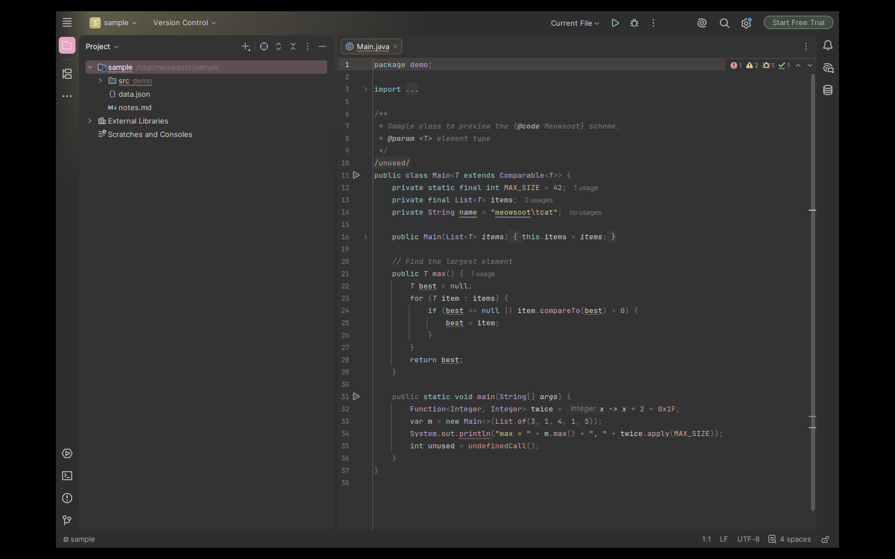
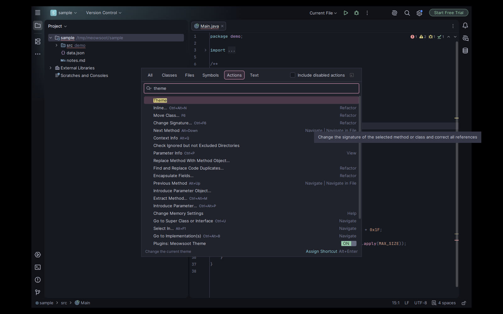
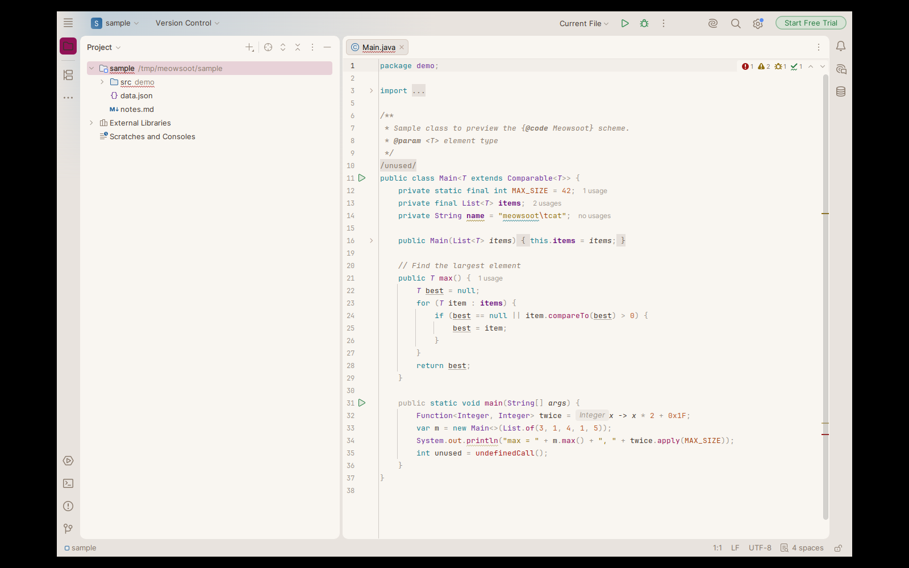

# Meowsoot for JetBrains IDEs

A port of [meowsoot.nvim](https://github.com/marekh19/meowsoot.nvim), a soft and cozy pastel theme, to IntelliJ-based IDEs.
It is built on top of the **Islands** UI (2025.3+).

| Variant | UI theme | Editor scheme |
|---|---|---|
| **Night**: warm-neutral dark | `Meowsoot Night` (parent *Islands Dark*) | `Meowsoot Night` (parent *Darcula*) |
| **Twilight**: Night colors on a lighter `#333333` background | `Meowsoot Twilight` (parent *Islands Dark*) | `Meowsoot Twilight` (parent *Darcula*) |
| **Moon**: cool, blue-tinted dark | `Meowsoot Moon` (parent *Islands Dark*) | `Meowsoot Moon` (parent *Darcula*) |
| **Dawn**: warm parchment light | `Meowsoot Dawn` (parent *Islands Light*) | `Meowsoot Dawn` (parent *Default*) |






## Install

```sh
./gradlew buildPlugin
```

Then, in the IDE, go to **Settings → Plugins → ⚙ → Install Plugin from Disk…** and pick `build/distributions/meowsoot-intellij-*.zip`.
Choose the theme in **Settings → Appearance & Behavior → Appearance**. Each UI theme switches to its matching editor scheme.

The build downloads IntelliJ IDEA (`platformVersion` in `gradle.properties`) to compile against.
To build against a local installation instead, pass `-PplatformLocalPath=/path/to/idea`, or set `platformLocalPath` in `~/.gradle/gradle.properties`.

## How it works

The themes are generated rather than hand-written. `scripts/generate.py` uses only the Python stdlib and needs no IDE installed. The code lives in `scripts/meowsoot/`:

| Module | Contents |
|---|---|
| `palette.py` | The meowsoot HSL palettes, ported from `palette.lua`. This is the only place to change colors. |
| `colors.py` | Hex colors resolved from a palette, plus derived ones (diff, search, rainbow). |
| `ramps.py` | The Islands color ramps (`gray-*`, `blue-*`, …) rebuilt from the palette, and the legacy names (`Gray1`, `grey01`, …) aliased onto them. |
| `tokens.py` | Islands semantic tokens (`text-*`, `accent-*`, `selection-*`, …) and project gradients. |
| `ui.py` | The UI keys whose parent value is a literal color, grouped by area. |
| `icons.py` | The icon color palette. |
| `editor.py`, `languages.py` | Editor scheme colors and text attributes. |
| `theme.py`, `scheme.py` | Writers for `.theme.json` and the scheme `.xml`. |

The UI themes extend *Islands Dark* / *Islands Light*. Most Islands UI keys refer to ramps and tokens by name, so redefining those recolors the whole UI. Only keys with literal colors in the parent need explicit values in `ui.py`.
The editor schemes extend *Darcula* / *Default* and override what meowsoot styles. Pink is the brand accent. Syntax colors follow the nvim highlight groups: cyan keywords, yellow strings, pink functions, lavender types and peach constants.

The output is committed to `src/main/resources/themes/`, so the Gradle build only packages it. To regenerate after changing the code:

```sh
python3 scripts/generate.py
```

## Credits

Palette and design are from [meowsoot.nvim](https://github.com/marekh19/meowsoot.nvim) by Marek Honzal, used under the MIT license. See [LICENSE](LICENSE).
