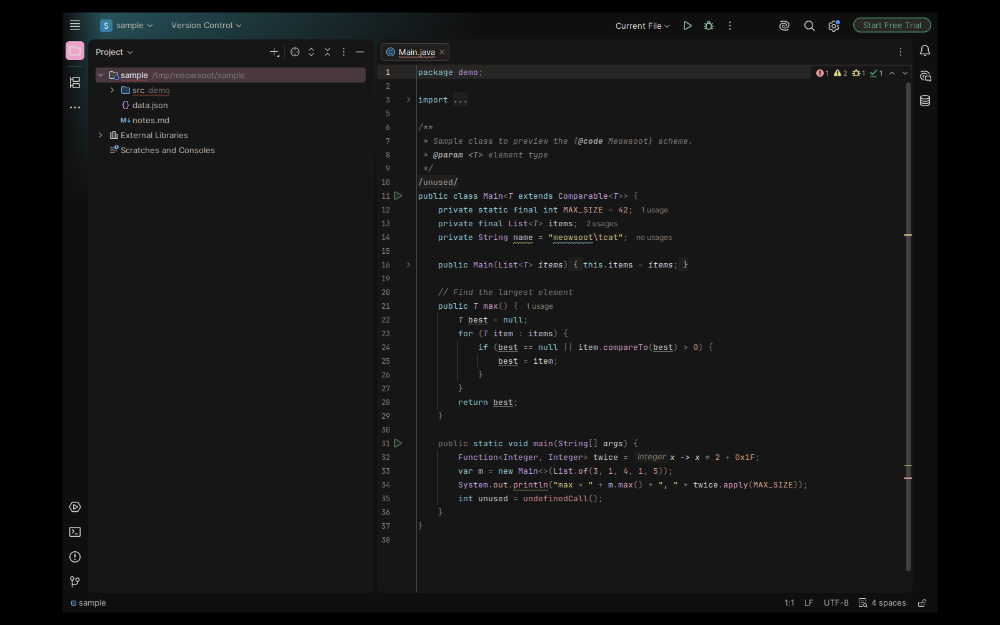
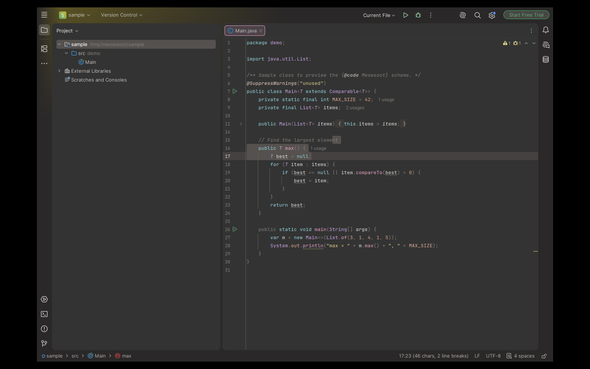
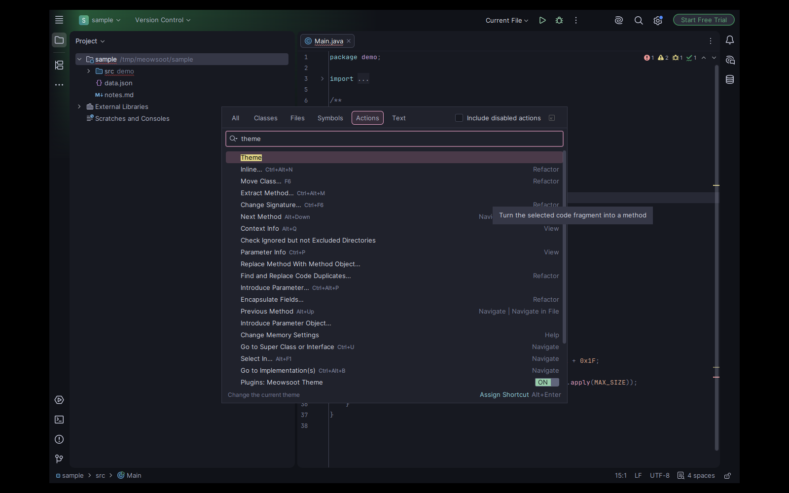
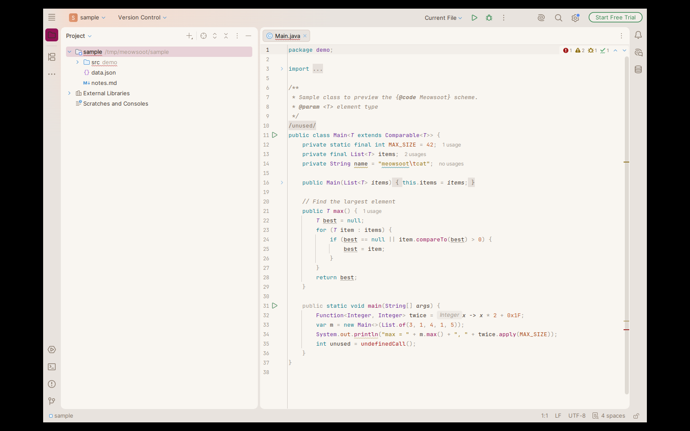

# Meowsoot for JetBrains IDEs

A port of [meowsoot.nvim](https://github.com/marekh19/meowsoot.nvim), a soft and cozy pastel theme, to IntelliJ-based IDEs.
It is built on top of the **Islands** UI (2025.3+).

| Variant | UI theme | Editor scheme |
|---|---|---|
| **Night**: warm-neutral dark | `Meowsoot Night` (parent *Islands Dark*) | `Meowsoot Night` (parent *Darcula*) |
| **Twilight**: Night colors on a lighter `#333333` background | `Meowsoot Twilight` (parent *Islands Dark*) | `Meowsoot Twilight` (parent *Darcula*) |
| **Moon**: cool, blue-tinted dark | `Meowsoot Moon` (parent *Islands Dark*) | `Meowsoot Moon` (parent *Darcula*) |
| **Dawn**: warm parchment light | `Meowsoot Dawn` (parent *Islands Light*) | `Meowsoot Dawn` (parent *Default*) |






## Install

```sh
./gradlew buildPlugin
```

Then, in the IDE, go to **Settings → Plugins → ⚙ → Install Plugin from Disk…** and pick `build/distributions/meowsoot-intellij-*.zip`.
Choose the theme in **Settings → Appearance & Behavior → Appearance**. Each UI theme switches to its matching editor scheme.

The build downloads IntelliJ IDEA (`platformVersion` in `gradle.properties`) to compile against.
To build against a local installation instead, pass `-PplatformLocalPath=/path/to/idea`.

## How it works

The themes are generated rather than hand-written. `scripts/generate.py` uses only the Python stdlib and does the following:

1. Ports the meowsoot HSL palette (`palette.lua`/`hsl.lua`) exactly, including the derived colors (diff, search and rainbow).
2. Reads the parent Islands themes and the Darcula/Default schemes from an installed IDE, along with the color settings pages contributed by bundled and installed plugins.
3. Rebuilds the Islands color ramps (`gray-*`, `blue-*`, …) from meowsoot colors and re-maps every other hard-coded parent color onto those ramps. Nothing inherited stays JetBrains-blue.
4. Layers the meowsoot semantics on top. Pink is the brand accent. Syntax colors follow the nvim highlight groups: cyan keywords, yellow strings, pink functions, lavender types and peach constants.

The output is committed to `src/main/resources/themes/`, so the Gradle build only packages it. To regenerate, for example after an IDE update:

```sh
python3 scripts/generate.py \
  --ide ~/.local/share/JetBrains/Toolbox/apps/intellij-idea \
  --plugins ~/.local/share/JetBrains/IntelliJIdea2026.2   # optional: user-installed plugins (e.g. Scala)
```

## Credits

Palette and design are from [meowsoot.nvim](https://github.com/marekh19/meowsoot.nvim) by Marek Honzal, used under the MIT license. See [LICENSE](LICENSE).
